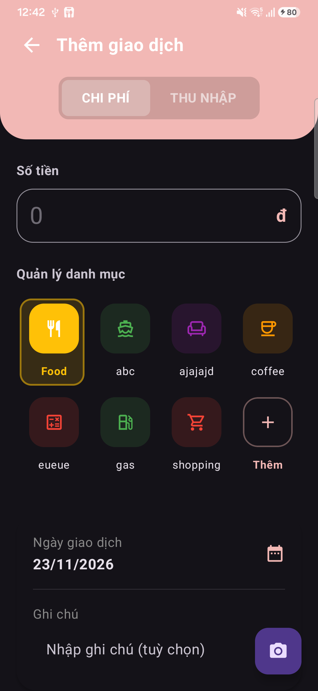
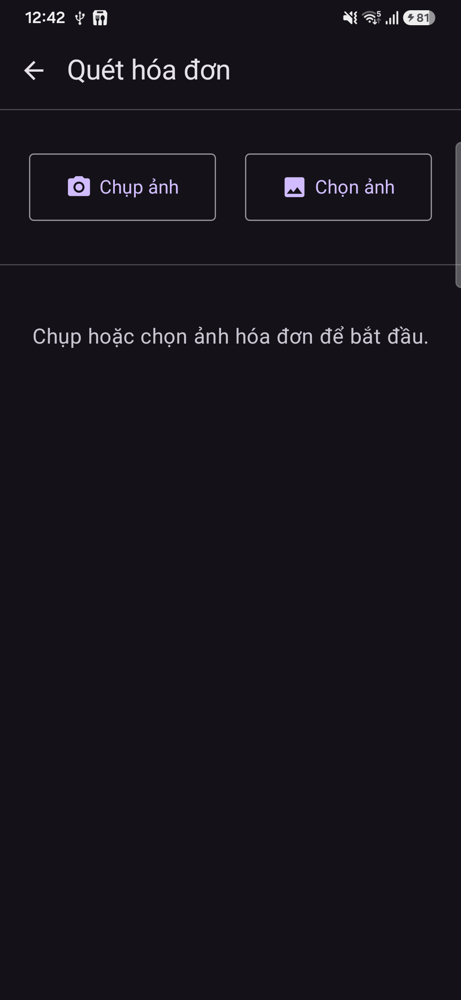
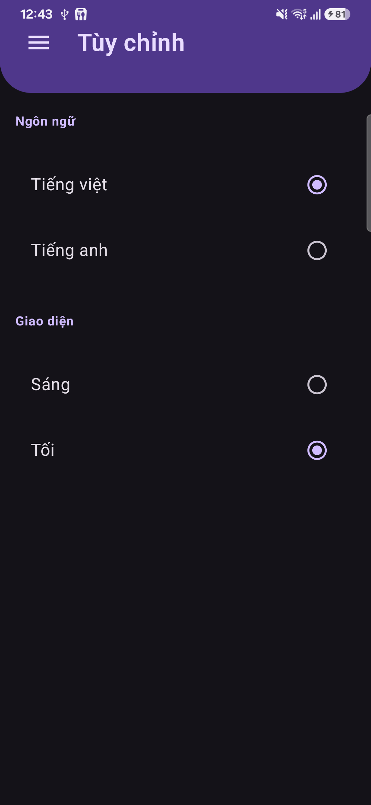
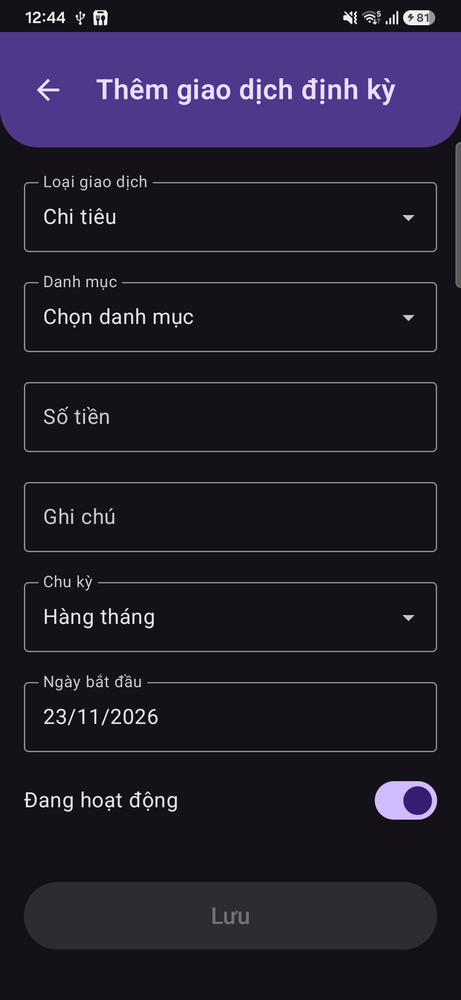
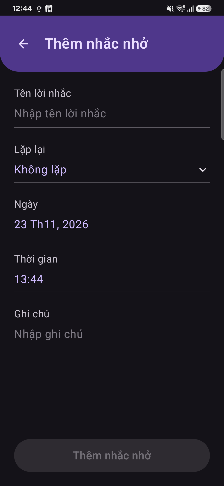
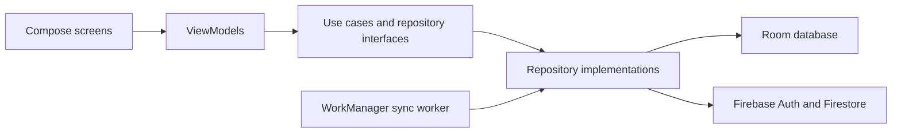

# MoneyMate

An Android personal finance app for recording income and expenses, planning monthly budgets, and reviewing spending. Built with Kotlin, Jetpack Compose, Room, and Firebase.

MoneyMate brings everyday money records into one place. You can categorize transactions, inspect trends, schedule recurring entries and reminders, and use a receipt photo to prefill an expense. The app reads finance data from a local Room database and syncs account data with Cloud Firestore when a signed-in user and network connection are available.

## Contents

- [Features](#features)
- [Screenshots](#screenshots)
- [Tech stack](#tech-stack)
- [Architecture](#architecture)
- [Project structure](#project-structure)
- [Getting started](#getting-started)
- [Using the app](#using-the-app)
- [Technical highlights](#technical-highlights)
- [Limitations](#limitations)
- [Author](#author)
- [License](#license)

## Features

- **Accounts:** Register and sign in with email and password or Google; request a password reset through Firebase Authentication.
- **Transactions and categories:** Add, edit, and delete income or expenses; manage categories; browse and search transaction history by text or amount.
- **Budgets and reports:** Set monthly category budgets, follow spending against limits, and explore income, expense, category breakdown, and monthly trend charts.
- **Recurring transactions and reminders:** Configure recurring income or expenses and receive scheduled reminder notifications, subject to Android notification and alarm permissions.
- **Receipt scanning:** Capture a receipt with CameraX or choose an image, extract text with ML Kit, and review suggested expense details before saving.
- **Personalization and app lock:** Switch between Vietnamese and English and choose light, dark, or system theme. Optionally protect app access with a PIN or supported biometric authentication.

## Screenshots

Captured from MoneyMate running on a Samsung Galaxy A34 (Android 16).

| Add transaction | Receipt scanning | Settings |
| :---: | :---: | :---: |
|  |  |  |

| Add recurring transaction | Add reminder |
| :---: | :---: |
|  |  |

## Tech stack

| Area | Implementation in this project |
| --- | --- |
| Language and UI | Kotlin; Jetpack Compose with Material 3 for screens and Compose Navigation for routes. Charts are drawn with Compose Canvas. |
| State and architecture | ViewModels, Kotlin coroutines and Flow, domain use cases, repository interfaces and implementations. Hilt provides dependencies. |
| Local data | Room stores account-scoped finance records; DataStore Preferences stores the theme choice. |
| Cloud and sign-in | Firebase Authentication handles accounts; Cloud Firestore stores synchronized finance records. Credential Manager and Google ID support Google sign-in. |
| Background work | WorkManager runs synchronization and due recurring transactions. AlarmManager and notifications handle reminders. |
| Receipt capture | CameraX captures images; ML Kit Text Recognition extracts text; application code validates and parses receipt fields. |
| Build | Gradle Wrapper 8.13, Android Gradle Plugin 8.13.2, Kotlin plugin 2.2.20, and KSP. |

The app is configured with **min SDK 26**, **compile SDK 36**, and **target SDK 36**. Its application ID is `com.example.moneymatev2`.

## Architecture

MoneyMate uses a layered, MVVM-style structure. Compose screens observe ViewModel state. ViewModels call domain use cases or repository interfaces; repository implementations coordinate Room and Firebase. Use cases cover operations such as transaction validation, authentication, budget summaries, and synchronization. Some screen logic calls repositories directly, so the layers are not applied uniformly everywhere.



Room backs the observable finance data used by the UI. Local edits are marked as pending, then uploaded to Firestore; a cloud pull merges remote records into Room. The sync worker runs with network constraints and retries eligible failures. Budget synchronization also records detected version conflicts. This is a practical local-first design, with conflict and connectivity behavior that still matters across devices.

## Project structure

```text
app/src/main/java/com/example/moneymatev2/
├── presentation/   Compose screens and ViewModels
├── navigation/     Routes and navigation graph
├── domain/         Models, repository contracts, and use cases
├── data/
│   ├── local/      Room entities, DAOs, database, and migrations
│   ├── remote/     Firestore DTOs and synchronization
│   ├── repository/ Repository implementations
│   ├── ocr/        Text recognition and receipt analysis
│   ├── reminder/   Alarm scheduling and notifications
│   └── security/   PIN credential storage
├── core/           Dependency injection and shared utilities
└── ui/             Shared UI components
```

## Getting started

### Prerequisites

- Android Studio with Android SDK Platform 36 and an emulator or device running Android 8.0 (API 26) or later.
- JDK 17 for the Gradle build. The source and Kotlin JVM targets are set to Java 11.
- A Firebase project for authentication and Firestore. The Gradle Wrapper is included; a separate Gradle installation is unnecessary.

### Configure Firebase

1. Register an Android app in your own Firebase project with package name `com.example.moneymatev2` and download its `google-services.json` to `app/google-services.json`. Replace the existing local file with your own configuration when using another Firebase project.
2. Enable the desired Firebase Authentication providers: Email/Password for email sign-in, and Google for Google sign-in. Create a Cloud Firestore database and configure rules for your project; inspect the repository's `firestore.rules` before using them in your own deployment.
3. For Google sign-in, register the signing certificate fingerprints in Firebase and set `default_web_client_id` in `app/src/main/res/values/strings.xml` to your own Firebase project's **Web client ID**. The current resource contains a project-specific ID and is read by the login and registration screens.

`google-services.json` is Firebase client configuration, not a service-account private key. Keep private keys and account credentials out of the repository. Check the files you stage before publishing a fork.

### Build and run

1. Clone the repository:

   ```bash
   git clone https://github.com/TranHuyHoang69/Do-an-tot-nghiep.git
   cd Do-an-tot-nghiep
   ```

2. Open the root directory in Android Studio and let Gradle sync. Select an emulator or connected device, then run the `app` configuration.
3. To build a debug APK from the command line, use the wrapper for your operating system:

   ```powershell
   .\gradlew.bat :app:assembleDebug
   ```

   ```bash
   ./gradlew :app:assembleDebug
   ```

The debug APK is generated at `app/build/outputs/apk/debug/app-debug.apk`. The repository does not provide a published release APK.

## Using the app

1. Create an account or sign in, then add an income or expense with an amount, date, and category.
2. Review entries on the home and history screens. Create monthly budgets and open Statistics to inspect spending by period and category.
3. For an expense receipt, open the scanner from the add-transaction form. Review the extracted amount, date, category, and note; correct the form before saving.
4. Optionally create recurring entries or reminders, and set a PIN and biometric unlock in Security settings.

## Technical highlights

- **Local-first synchronization:** Room supplies observable records while repository writes mark local changes as pending. WorkManager uploads pending operations and pulls Firestore data when constraints permit. The implementation tracks auth sessions and budget version conflicts to avoid silently overwriting some competing edits; it does not promise instant or lossless cross-device sync.
- **Receipt interpretation:** ML Kit supplies recognized text and line positions. App-owned validation and parsing use receipt context, amount labels, date parsing, and category suggestions. Uncertain results require confirmation, and recognized fields only prefill the transaction form; the user saves the final transaction.
- **Recurring entry generation:** Due templates advance their schedule cursor and insert transactions in a Room transaction. A deterministic occurrence ID and `INSERT IGNORE` help prevent duplicate local entries during worker retries.
- **Local app lock:** The optional PIN verifier uses PBKDF2-HMAC-SHA256 with a salt and an Android Keystore-backed HMAC key. BiometricPrompt provides biometric unlock when supported and enabled. This protects access to the app; it is not a claim that all stored finance data is encrypted by the PIN.

## Limitations

- Receipt extraction depends on image quality and receipt layout; missing or uncertain values need manual review.
- Cloud synchronization depends on authentication, connectivity, and successful background execution. Conflicting edits, especially across devices, can require resolution.
- Reminder delivery depends on Android notification settings and alarm permission or scheduling policy.
- The repository currently has no published installable release.

## Author

Developed by [Tran Huy Hoang](https://github.com/TranHuyHoang69) as an Android graduation project. The project is maintained in this repository.

## License

No license file is currently published in this repository. Contact the author before reusing or redistributing the code.
